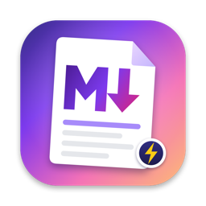
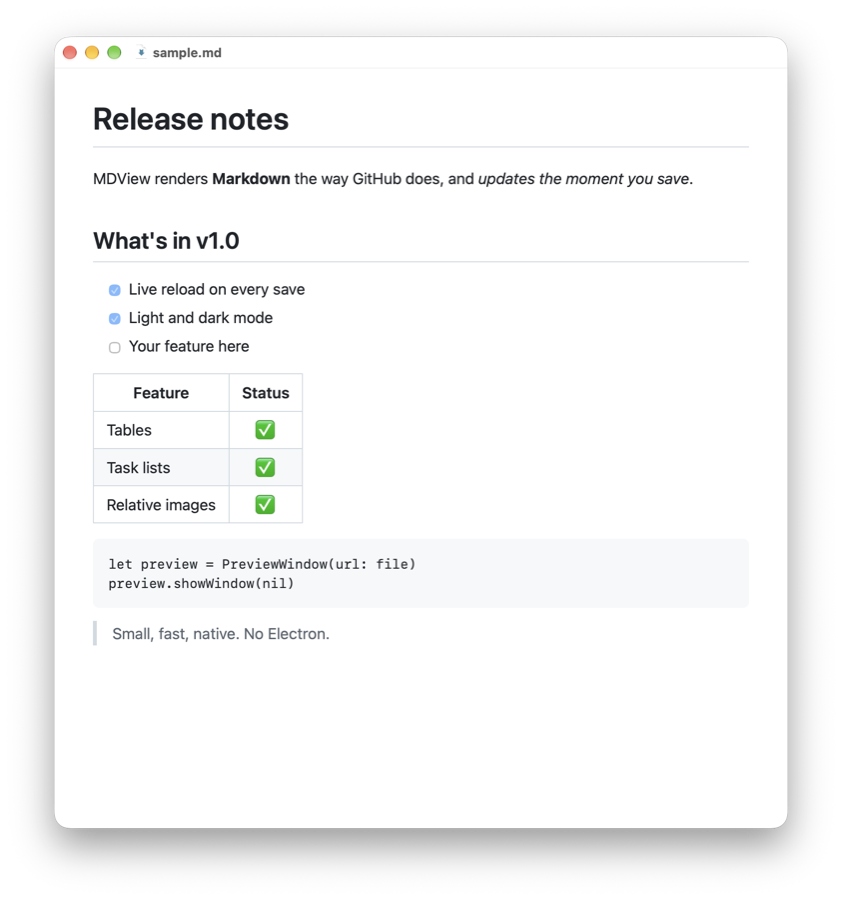

<p align="center"></p>

<h1 align="center">MDView</h1>

<p align="center">A tiny, fast, native Markdown previewer for macOS. About 200&nbsp;KB, no Electron.</p>

<p align="center"></p>

## Features

- **Live reload**: the preview updates the moment you save, whichever editor you use.
- GitHub-style rendering: tables, task lists, code blocks, quotes, images next to the file.
- Follows light and dark mode.
- Links to other `.md` files open in MDView; web links open in your browser.
- Hides YAML front matter.
- Safe to open untrusted files: scripts inside a Markdown file cannot run.

Shortcuts: <kbd>⌘O</kbd> open · <kbd>⌘R</kbd> reload · <kbd>⌘=</kbd> / <kbd>⌘-</kbd> / <kbd>⌘0</kbd> zoom · <kbd>⇧⌘R</kbd> reveal in Finder

## Install

1. Download **MDView.zip** from the [latest release](https://github.com/beniamin-levin/mdview/releases/latest) and unzip it.
2. Move `MDView.app` to `/Applications`.
3. The app is not notarised, so macOS blocks it the first time. Clear the download flag once:

   ```bash
   xattr -dr com.apple.quarantine /Applications/MDView.app
   ```

Then open a file with **Open With → MDView**, or from the terminal:

```bash
open -a MDView README.md
```

To make it the default for `.md` files: select one in Finder, press <kbd>⌘I</kbd>, pick MDView under *Open with* and click **Change All…**.

Requires macOS 13 or later (Apple Silicon or Intel).

## Build from source

Needs the Xcode command line tools.

```bash
./build.sh
```

This builds a universal `MDView.app` and installs it to `~/Applications`.
The icon is drawn in code by [`icon/make_icon.swift`](icon/make_icon.swift).

## How it works

One Swift file ([`main.swift`](main.swift)): an AppKit window with a `WKWebView`, and a file watcher that re-renders on change. Markdown is converted by [marked](https://github.com/markedjs/marked) (MIT, bundled in `Resources/`). A strict Content Security Policy lets only the bundled scripts run.

## License

MIT. See [LICENSE](LICENSE). Bundled marked is under its own MIT licence ([Resources/marked-LICENSE.md](Resources/marked-LICENSE.md)).
